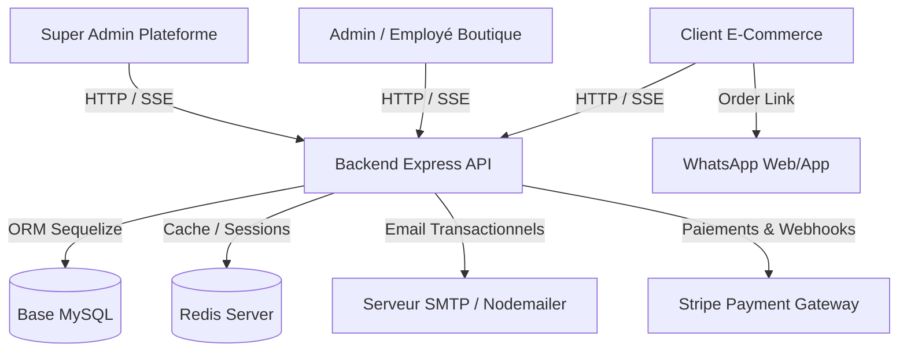

# 🛒 Comores Biachara / EasyMarket — Plateforme E-Commerce Multi-Boutiques SaaS

[](https://nodejs.org/)
[](https://react.dev/)
[](https://expressjs.com/)
[](https://www.mysql.com/)
[](https://sequelize.org/)
[](https://www.docker.com/)

**Comores Biachara (EasyMarket)** est une solution e-commerce SaaS multi-boutiques ultra-moderne, complète et hautement performante. La plateforme permet la création et la gestion multi-tenant de boutiques en ligne autonomes, intégrant à la fois la vente en ligne (front-office), la vente directe en magasin (Caisse / POS), la gestion des stocks, des employés, de la comptabilité, des notifications en temps réel et des paiements hybrides (Stripe, WhatsApp, Espèces, Mvola, Wero/Holam).

---

## 🌟 Sommaire

1. [Aperçu de l'Architecture](#-aperçu-de-larchitecture)
2. [Fonctionnalités Clés](#-fonctionnalités-clés)
3. [Technologies & Stack Technique](#-technologies--stack-technique)
4. [Installation & Démarrage Rapide](#-installation--démarrage-rapide)
5. [Variables d'Environnement](#-variables-denvironnement)
6. [Comptes de Démonstration](#-comptes-de-démonstration)
7. [Structure du Projet](#-structure-du-projet)

---

## 🏗️ Aperçu de l'Architecture

L'application repose sur un modèle d'architecture isolée multi-tenant et réactive :

```
easymarket/
├── backend/            # API REST Node.js / Express / Sequelize / MySQL / JWT / SSE / Nodemailer
├── frontend/           # Application SPA React (Vite) avec Vanilla CSS design system
├── database/           # Schéma SQL de référence & scripts de migration
└── docker-compose.yml  # Orchestration complète (Node API, React, MySQL, Redis)
```



---

## 🚀 Fonctionnalités Clés

### 🛍️ 1. Front-Office (Boutique Client)
- **Catalogue Dynamique & Recherche Instantanée** : Filtres par catégories, tri par prix/popularité, badges de promotion et statut de stock en temps réel.
- **Fiche Produit Haute-Fidélité** : Galerie d'images avec zoom interactif sur survol, calcul de prix unitaire au kilo/poids, stock dynamique et avis vérifiés.
- **Commande WhatsApp Directe** : Génération automatique d'un message WhatsApp structuré et lisible contenant le nom du client, la date, la liste complète des articles, quantités, prix unitaires, sous-total et total, redirigeant directement vers le contact WhatsApp de la boutique.
- **Tunnel de Commande Flexible (Checkout)** :
  - Modes de livraison : Livraison à domicile ou Retrait en boutique.
  - Modes de paiement : Paiement à la livraison (Cash), Carte Bancaire (Stripe), Mvola, Wero/Holam, WhatsApp.
  - Réservation de stock en transaction atomique (`LOCK.UPDATE`).
- **Suivi de Commande & Historique Client** : Chronologie visuelle de l'avancement de la commande (Reçue → Confirmée → Prête / En livraison → Livrée/Récupérée), téléchargement du reçu, annulation en un clic.
- **Système d'Avis Vérifiés** : Dépôt d'avis avec note en étoiles et commentaire réservé exclusivement aux clients ayant commandé et récupéré le produit.

### 🏢 2. Back-Office Admin & Caisse (Gestion Boutique)
- **Tableau de Bord & Analytics** : Chiffre d'affaires global, bénéfice net estimé, panier moyen, alertes de réapprovisionnement, graphiques des ventes sur 7 jours et top produits.
- **Gestion des Commandes** : Mise à jour en temps réel des statuts (Valider, Préparer, Mettre en livraison, Marquer comme récupérée), attribution de livreurs/employés, annulation.
- **Caisse & Vente Directe (POS)** : Interface ultra-rapide pour les ventes physiques en magasin, recherche produit au code-barres/nom, encaissement rapide, impression/affichage des reçus.
- **Gestion du Catalogue & des Stocks** : CRUD complet des produits, prix promotions, gestion des catégories, unités de vente (kg, pièce, litre) et alertes de stock critique.
- **Gestion des Achats & Fournisseurs** : Enregistrement des réapprovisionnements auprès des fournisseurs, suivi des coûts d'achat et mise à jour automatique des stocks.
- **Gestion des Depenses & Frais de Gestion** : Suivi comptable des charges d'exploitation de la boutique (loyer, électricité, salaires, transport).
- **Gestion des Employés & Droits (RBAC)** : Création de comptes d'employés avec attribution de permissions personnalisées (*Caisse*, *Commandes*, *Stock*, *Rapports*).
- **Personnalisation de la Boutique** : Logo, bannières du slider d'accueil, bannières secondaires, couleurs, mode sombre/clair, coordonnées WhatsApp et politiques de livraison.

### 👑 3. Console Super-Admin (Plateforme SaaS)
- **Supervision Multi-Boutiques** : Vue consolidée sur l'ensemble des boutiques de la plateforme (CA cumulé, nombre total de commandes, boutiques actives/suspendues).
- **Gestion des Tenant & Boutiques** : Création instantanée de nouvelles boutiques avec génération automatique des identifiants d'administrateur.
- **Gestion Globale des Utilisateurs** : Suspension, réactivation, changement de rôle et réinitialisation des accès.

---

## 🛠️ Technologies & Stack Technique

### Frontend
- **Framework** : React 18 + Vite (Chargement rapide & HMR)
- **Styles** : Vanilla CSS avec CSS Variables (Design System sur mesure, Glassmorphism, animations fluides, Support complet **Dark Mode / Light Mode**)
- **Icônes** : Lucide React
- **Routage** : React Router DOM v6
- **Temps Réel** : Client SSE (`subscribeRealtime`) avec reconnexion automatique

### Backend
- **Runtime** : Node.js (Express v4)
- **ORM & Base de données** : Sequelize v6 avec MySQL 8
- **Paiements** : Stripe SDK (Checkout sessions & webhook listener)
- **Emails** : Nodemailer (SMTP, templates HTML responsive)
- **Sécurité & Auth** : JWT (JSON Web Tokens), Bcrypt.js (hachage des mots de passe), CORS sécurisé, transactions SQL atomiques.
- **Temps Réel** : Server-Sent Events (SSE) natif Express pour le push d'évènements instantanés.

---

## ⚡ Installation & Démarrage Rapide

### Option A : Avec Docker Compose (Recommandé)

1. Clonez le dépôt et naviguez dans le dossier :
   ```bash
   git clone https://github.com/votre-org/easymarket.git
   cd easymarket
   ```

2. Lancez tous les services avec Docker Compose :
   ```bash
   docker-compose up --build
   ```

3. L'application est prête :
   - **Frontend (Application web)** : [http://localhost:5173](http://localhost:5173)
   - **Backend API REST** : [http://localhost:4000/api](http://localhost:4000/api)
   - **Base de données MySQL** : `localhost:3306`

---

### Option B : Déploiement Local Sans Docker

#### 1. Configuration de la Base de Données
Créez une base de données MySQL vide :
```sql
CREATE DATABASE boutique_saas CHARACTER SET utf8mb4 COLLATE utf8mb4_unicode_ci;
```

#### 2. Configuration & Lancement du Backend
```bash
cd backend
cp .env.example .env
# Modifiez les informations de connexion MySQL dans .env
npm install
npm run dev
```
*(Le backend crée automatiquement toutes les tables et initialise les données de démonstration lors du premier démarrage).*

#### 3. Configuration & Lancement du Frontend
```bash
cd frontend
cp .env.example .env
npm install
npm run dev
```

---

## 🔑 Variables d'Environnement

### Backend (`backend/.env`)
```env
PORT=4000
NODE_ENV=development
DB_HOST=localhost
DB_PORT=3306
DB_USER=root
DB_PASS=password
DB_NAME=boutique_saas
JWT_SECRET=super_secret_jwt_key_easymarket_2026
FRONTEND_URL=http://localhost:5173

# Configuration SMTP Emailing
SMTP_HOST=smtp.gmail.com
SMTP_PORT=587
SMTP_USER=votre-email@gmail.com
SMTP_PASS=votre-mot-de-passe-application

# Stripe Gateway
STRIPE_SECRET_KEY=sk_test_...
STRIPE_WEBHOOK_SECRET=whsec_...
```

---

## 👤 Comptes de Démonstration

Lors du premier démarrage, les comptes suivants sont automatiquement créés :

| Rôle | Identifiant / Email | Mot de passe | URL d'accès |
| :--- | :--- | :--- | :--- |
| **Super Admin** | `superadmin@boutique-saas.com` | `SuperAdmin123!` | `/super-admin` |
| **Admin Boutique** | `admin@marche-vert.com` | `Admin123!` | `/admin` |
| **Employé** | `ibrahima@marche-vert.com` | `Employe123!` | `/admin` |
| **Client** | `client@example.com` | `Client123!` | `/` |

---

## 📁 Structure du Projet

```
easymarket/
├── backend/
│   ├── src/
│   │   ├── config/          # Configuration Sequelize DB & variables
│   │   ├── models/          # Modèles Sequelize (User, Boutique, Product, Order, etc.)
│   │   ├── routes/          # Endpoints API REST (auth, store, admin, superadmin, stripe)
│   │   ├── services/        # Service d'envoi d'emails Nodemailer
│   │   ├── utils/           # Diffusion SSE Temps Réel (realtime.js)
│   │   ├── seed.js          # Seeder de démonstration automatique
│   │   └── server.js        # Point d'entrée serveur Express
│   └── package.json
├── frontend/
│   ├── src/
│   │   ├── components/      # Composants UI réutilisables (Header, Footer, ProductCard, Stars)
│   │   ├── context/         # AuthContext, CartContext
│   │   ├── pages/
│   │   │   ├── store/       # Pages Boutique (Home, Catalog, ProductDetail, Checkout, MyOrders)
│   │   │   ├── admin/       # Back-office Boutique (Dashboard, Orders, POS, Inventory, Employees)
│   │   │   └── superadmin/  # Console Super Admin Plateforme
│   │   ├── utils/           # Helper WhatsApp (whatsappOrder.js), SSE Realtime Client
│   │   ├── api.js           # Client Axios centralisé
│   │   └── index.css        # Design System & tokens CSS global (variables dark/light)
│   └── package.json
├── docker-compose.yml
├── README.md
└── REALISATION_TECHNIQUE.md  # Documentation technique interne complète
```

---

## 📜 Licence & Droits

Tous droits réservés © 2026 **Comores Biachara / EasyMarket**. Solide, évolutif et prêt pour la production.
